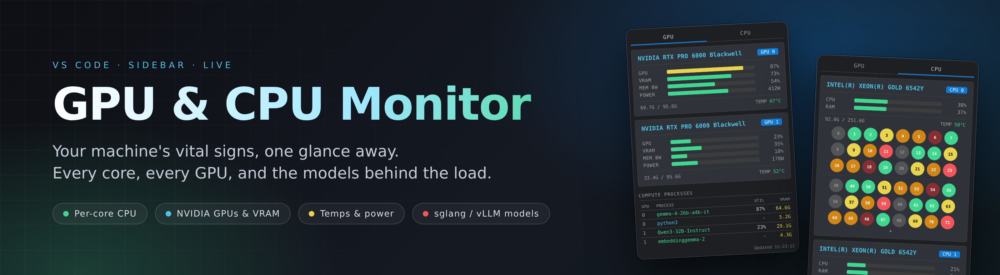
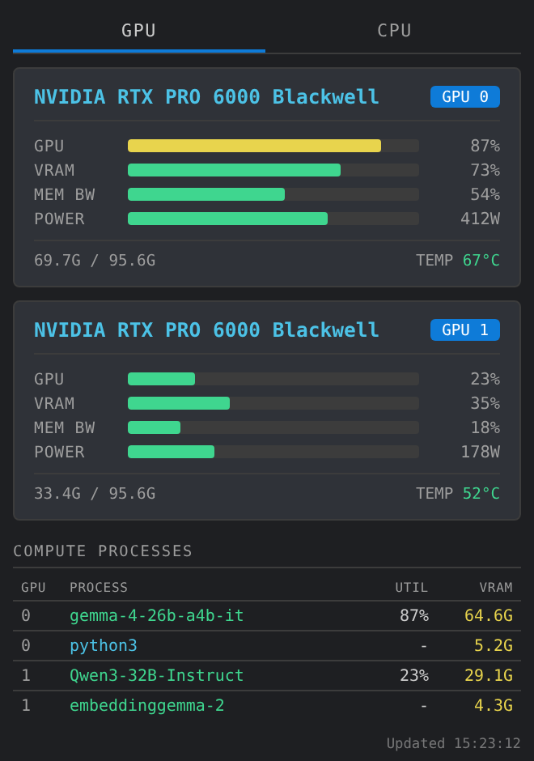
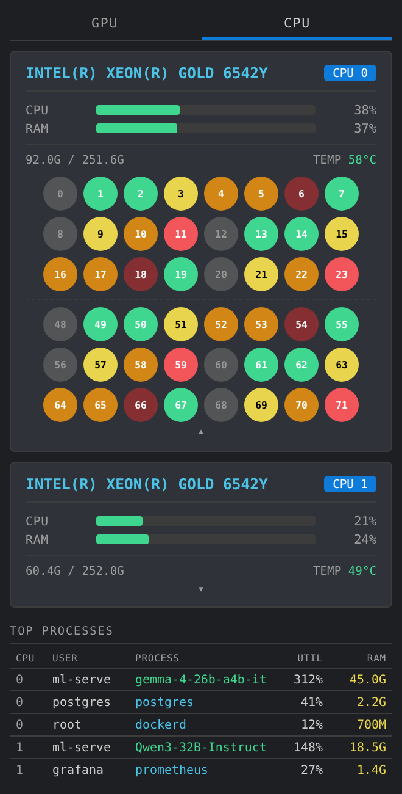
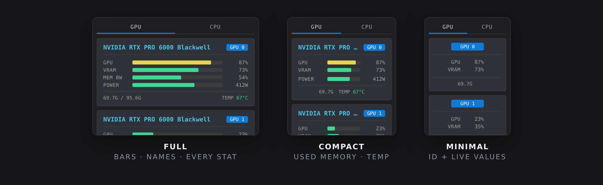

<p align="center">
  
</p>

<p align="center">
  
  
  
  
</p>

<h3 align="center">Your machine's vital signs, one glance away.</h3>

<p align="center">
  Stop alt-tabbing to a terminal to run <code>nvidia-smi</code> and <code>htop</code>.<br>
  <b>GPU &amp; CPU Monitor</b> lives in your VS Code sidebar and shows every GPU, every core,
  and the exact processes (and models) behind the load, live, while you work.
</p>

---

## Why you'll like it

You are training a model, serving an LLM, or just wondering why the fans are screaming.
The answer is on your machine, and getting to it should cost you nothing. This extension turns the
two commands you keep retyping into a calm, glanceable panel that sits right next to your code.

- **One look, full picture.** GPU load, VRAM, memory bandwidth, power, temperature, per-core CPU
  load and RAM, all in one place.
- **It knows what's running.** Processes on your GPUs show the **model name** if they belong to
  an [SGLang](https://github.com/sgl-project/sglang) or [vLLM](https://github.com/vllm-project/vllm)
  server, not a cryptic `python3`.
- **It stays out of your way.** Light on resources, quiet on screen, and it adapts to any sidebar width.

---

## The GPU tab

<p align="center">
  
</p>

**A card for every GPU**, with utilization, VRAM, memory bandwidth and power as clean bars that
shift from green to yellow to red as load climbs, plus used and total VRAM and the live temperature.

**A compute process table that tells you what is actually going on:**

| | |
|---|---|
| **Process** | The model name for SGLang and vLLM workers, the process name for everything else |
| **Util** | Per-process GPU utilization (`-` when idle) |
| **VRAM** | How much memory that process holds |
| **Order** | Grouped by GPU, then by VRAM from highest to lowest, for any number of GPUs |

> **Tip:** click any process row to copy its **PID** to your clipboard. Handy for the `kill` you were about to type.

### How model names are found

SGLang and vLLM run their work in child processes whose names say very little. The extension walks up
the process tree to the server that launched them and reads its arguments, preferring
`--served-model-name`, then `--model-path` / `--model`, then `vllm serve <model>`. The result is cached,
so it is effectively free.

---

## The CPU tab

<p align="center">
  
</p>

**A card for every physical processor.** Dual-socket server? You get two cards, each with its own CPU
utilization, its own RAM (read per NUMA node, so the numbers are honest), and its package temperature.

**Click a card to open the cores.** A smooth, eased animation reveals every logical core as a round
button showing its **real core number**, colored by load:

| Load | Color |
|---|---|
| 0% | Gray |
| under 25% | Green |
| 25% to 49% | Yellow |
| 50% to 74% | Orange |
| 75% to 99% | Red |
| exactly 100% | Deep red |

Colors cross-fade as load changes (and the circles can become boxes, or any colors you like, see
[Make it yours](#make-it-yours)), and hyperthread siblings (for example `0-23` then `48-71`) are
drawn as separate runs with a faint divider, so the numbering always makes sense at a glance.

**Top processes**, with the **user** who owns each one and the same model-name detection as the GPU
tab. Utilization is per core, like `top`, so a busy multi-threaded process can exceed 100%. Click a
row to copy its PID.

---

## Make it yours

The look of the core buttons lives in a plain JSON file you control. Point the extension at it:

```jsonc
// settings.json
"nvidiagpumonitor.appearanceFile": "~/gpu-monitor.json"
```

```json
{
  "core": { "shape": "circle", "size": 28, "radius": 6, "gap": 5 },
  "levels": [
    { "max": 0,   "color": "#6b6b6b", "text": "#dddddd", "opacity": 0.6 },
    { "max": 24,  "color": "#3fd68f", "text": "#ffffff" },
    { "max": 49,  "color": "#e8d44d", "text": "#000000" },
    { "max": 74,  "color": "#d18616", "text": "#ffffff" },
    { "max": 99,  "color": "#f2555a", "text": "#ffffff" },
    { "max": 100, "color": "#8c2a2e", "text": "#ffffff" }
  ]
}
```

| Key | What it does |
|---|---|
| `core.shape` | `"circle"` (default) or `"box"` |
| `core.size` | Size of each core in px (14 to 48) |
| `core.radius` | Corner rounding in px (0 to 24), used when the shape is `"box"` |
| `core.gap` | Space between cores in px (0 to 16) |
| `levels[].max` | The level applies to loads up to and including this percentage |
| `levels[].color` | Any CSS color, including theme variables like `var(--vscode-terminal-ansiGreen)` |
| `levels[].text` | Color of the core number (optional) |
| `levels[].opacity` | 0 to 1 (optional) |

Edits apply **live**, with no reload. Anything missing or invalid quietly falls back to the defaults,
so a typo can never break the panel. A ready-to-copy file ships as
[`appearance.example.json`](appearance.example.json). Relative paths are resolved from your workspace
folder, and `~/` works too.

---

## Beautiful at every size

<p align="center">
  
</p>

Narrow the sidebar and the panel **does not crumble. It simplifies.** Each stage collapses with one
smooth easing curve instead of snapping:

1. **Full:** bars, names and every stat.
2. **Compact:** totals fold away and you keep what is *used*, plus the temperature.
3. **Minimal:** bars give way to live percentages, names step aside, and the card is centered around
   its **GPU / CPU ID**.

Columns that carry no information are removed for you. A single-GPU or single-CPU machine will not see
a pointless index column.

---

## Gentle on your machine

A monitor should never become the thing you are monitoring.

- Only the **tab you are looking at** is sampled.
- Everything runs **asynchronously**, so the editor never waits on `nvidia-smi`.
- A refresh is **skipped** if the previous one is still running, so slow reads cannot pile up.
- Hidden panel? Polling **pauses** until you open it again.

---

## Requirements

| | |
|---|---|
| **VS Code** | 1.80 or newer |
| **GPU tab** | An NVIDIA GPU with `nvidia-smi` on your `PATH`. Per-process utilization uses `nvidia-smi pmon` where the driver supports it. |
| **CPU tab** | Linux. Core topology, RAM per node, processes and temperatures come from `/proc` and `/sys`. |
| **CPU temperature** | Intel `coretemp` sensors. If your machine has no such sensor, the temperature is simply left out. |

Developed and tested on Linux. Other platforms are untested.

---

## Install

**From a VSIX**

```bash
code --install-extension gpu-monitoring-service-0.2.0.vsix
```

**From source**

```bash
npm install
npm run compile
npx vsce package          # builds the .vsix
code --install-extension gpu-monitoring-service-0.2.0.vsix
```

Then open the **GPU & CPU Monitor** icon in the activity bar.

Working over **Remote - SSH**? Install it on the remote host and the panel shows that machine's GPUs
and CPUs, which is usually exactly what you want.

---

## Settings

| Setting | Default | Description |
|---|---|---|
| `nvidiagpumonitor.refreshInterval` | `2000` | How often to refresh, in milliseconds (500 to 30000) |
| `nvidiagpumonitor.nvidiaSmiPath` | `nvidia-smi` | Path to the `nvidia-smi` executable |
| `nvidiagpumonitor.appearanceFile` | *(empty)* | Path to a JSON file that styles the CPU core buttons |

**Command:** `GPU & CPU Monitor: Refresh Now` forces an immediate update.

---

## Privacy

Everything happens **locally**. The extension makes no network requests and collects no telemetry.
To recognize SGLang and vLLM models it reads process command lines, extracts only the model name,
and keeps nothing.

---

## Troubleshooting

Something not right? Open **View → Output** and pick **GPU & CPU Monitor** for a log of every failure
(raw error text included). Problems also show up in the panel itself, in plain language.

**"nvidia-smi error" banner.** The executable was not found or the driver is not responding. Run
`nvidia-smi` in a terminal, or set the full path in `nvidiagpumonitor.nvidiaSmiPath`.

**Process utilization always shows `-`.** Your driver may not support `nvidia-smi pmon`. Everything else
keeps working.

**A process shows `python3` instead of a model.** Only SGLang and vLLM launches are recognized, and only
when the server's command line includes the model argument.

**No CPU temperature.** Your machine has no Intel `coretemp` sensor exposed under `/sys/class/hwmon`.

---

<p align="center"><sub>
  The screenshots above use sample data so no real machine details are shown.<br>
  Built for people who like to see what their hardware is doing.
</sub></p>
